# JCHENG Robotics

**English** | [简体中文](https://github.com/JCHENG-Robotics/.github/blob/main/profile/README.zh-CN.md)

<p align="center">
  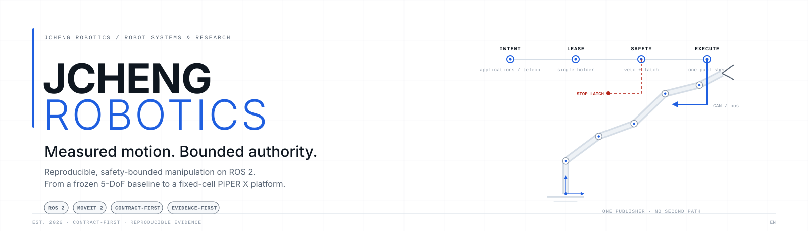
  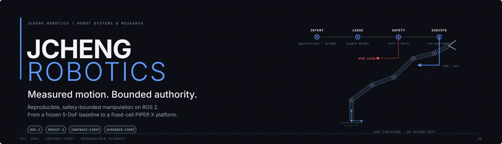
</p>

**Reproducible, safety-bounded robot manipulation.**  
An engineering organization for measured motion, explicit contracts and auditable evidence — from a frozen 5-DoF baseline to a fixed-cell PiPER X platform.

**Status data:** 2026-11-28 · **Frozen baseline:** `jcheng-manipulation v1.0.0` · **Deployment:** not ready<br>
**Start here:** [Current status](#current-status) · [Architecture](#ecosystem-architecture) · [Evidence](#experimental-evidence) · [Roadmap](#research--development-roadmap) · [Developer resources](#developer-resources)

---

## Project Overview

JCHENG Robotics builds robot-manipulation systems whose claims can be traced to evidence. The work began as a long-term personal development project on a low-cost 5-DoF ArmPi Ultra and now spans an independently versioned ecosystem: contracts, a privileged runtime, capability modules, operator tooling, simulation, benchmarks and governance.

Two rules have not changed:

1. **Every claim is traceable.** Results carry a command, log, dataset or machine-readable report. Unmeasured quantities are labelled.
2. **Every real-robot motion passes one boundary.** Intent is validated and arbitrated before any hardware command is published. No module gets a second path to the actuators.

| This is | This is not |
|---|---|
| A research-grade engineering portfolio with a working offline/mock ecosystem | A certified safety system, a production deployment or a general-purpose robot platform |
| A frozen baseline with scoped hardware evidence on one ArmPi Ultra | A population-level reliability claim, or evidence that transfers to PiPER X / AR5 |
| An offline-first ecosystem with explicit contracts and evidence classes | A finished v1.0 ecosystem: Baseline 1 is technically complete but formal completion awaits #40, and deployment is not ready |

## Engineering Highlights

| | |
|---|---|
| **One motion authority.** `jcheng-system` owns the lease, safety veto, arbitration, execution and the only hardware publisher. MoveIt plans; the arbiter executes. | **Contract-first.** `jcheng-interfaces` v0.3.0 released the multi-chain profile on 2026-11-28; the signed v0.2.0 pin still serves 7 of 8 runtime consumers while migration proceeds; perception carries an explicit waiver. |
| **Evidence before claims.** The baseline reports its failed 6 mm error-budget bound next to the 3.080 mm empirical mean — a different statistic, not a pass. | **Measured, not assumed.** 14-pose hand–eye calibration (2.94 mm / 0.39°), 0.449 mm RMS repeatability, 1.117 mm backlash, bus-verified motion. |
| **Platform transition.** ArmPi Ultra was frozen on 2026-11-28. The successor is a fixed-cell PiPER X; AR5 is gated on six identity facts; mobile manipulation is deferred. | **Offline by default.** Devices, scenarios, simulation, learning, benchmark and research declare or measure; they never execute. |

## Current Status

> **Verification is platform-scoped.** ArmPi results do not transfer to PiPER X or AR5. `Hardware verified` means the named scope passed on the named platform — not that the repository or the ecosystem is deployment-ready.

| Area | State | Evidence / next step |
|---|---|---|
| **Frozen baseline** | **Frozen** — `jcheng-manipulation v1.0.0` @ `b3411e4`; MIT; baseline full G8 recorded 2026-11-23 | Scoped L5 hardware evidence on one ArmPi Ultra; the platform as a whole was never validated end to end. [Evidence](#experimental-evidence) |
| **Platform** | **ArmPi Ultra: Frozen** (2026-11-28) · **PiPER X: P2 read-only in progress** · **AR5: planned / identity gate** | Pivot approved; publication of the freeze record is in progress. [Transition](https://github.com/JCHENG-Robotics/.github/blob/main/docs/platform-transition.md) |
| **Ecosystem Baseline 1** | **Offline integration: technical acceptance PASS; formal COMPLETE after record #40 is approved/merged** | `BASELINE 1 COMPLETE: NO — pending #40` · `DEPLOYMENT READY: NO`. [Record](https://github.com/JCHENG-Robotics/.github/blob/main/docs/baseline1/README.md) |
| **Contracts** | `jcheng-interfaces v0.3.0` released 2026-11-28 (robot-profile v2, `chain_id`, gripper units); **v0.2.0 remains the signed deployed pin** for 7/8 consumers; migration in progress | Baseline 1 was recorded against v0.2.0; perception is on `>=0.1,<0.2` with a waiver. [Contracts](https://github.com/JCHENG-Robotics/jcheng-interfaces) |
| **Runtime** | `jcheng-system 0.3.0-dev0` — 14 ROS packages; ArmPi M4/M5.2/S13/S17 verified; PiPER read-only backend implemented; acceptance pending | No PiPER motion; no production deployment. [System](https://github.com/JCHENG-Robotics/jcheng-system) |
| **Capabilities** | Perception, mobile, learning, teleop, devices, scenarios, simulation, studio, applications — **Experimental** | Strongest evidence per repository is in the [capability matrix](#core-capabilities). |
| **Deployment** | **Not ready** — no cross-process lease source, no base hardware bridge, no certificate-based DDS authority | This is not a production system. |
| **Safety** | **No certification.** No e-stop, brake, independent encoder, torque sensing or self-collision model | A software stop is a hold/zero command, not a safety-rated stop. |

**Status vocabulary:** `Frozen` · `Hardware verified` · `Offline verified` · `Experimental` · `Planned` · `Dormant` · `Conditional` · `Not ready`. Definitions and evidence classes are in [docs/evidence.md](https://github.com/JCHENG-Robotics/.github/blob/main/docs/evidence.md#2-status-vocabulary).

## Ecosystem Architecture

<p align="center">
  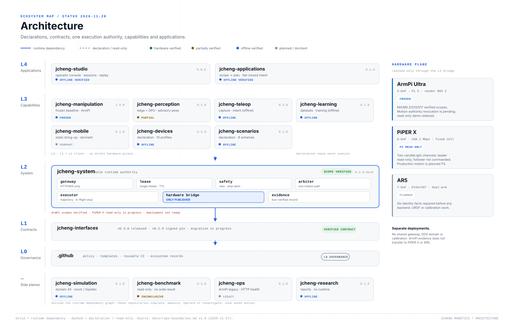
  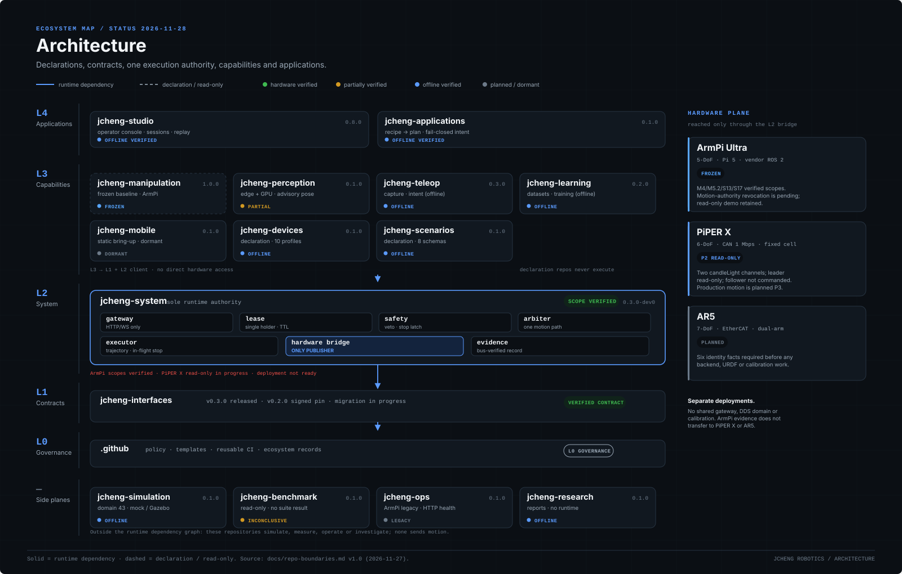
</p>
<p align="center"><sub><a href="https://raw.githubusercontent.com/JCHENG-Robotics/.github/main/profile/assets/architecture-light.svg">Open full-size architecture</a></sub></p>

The architecture separates **declarations**, **contracts**, **privileged execution**, **capabilities** and **applications**. Only L2 publishes motion.

| Layer | Repositories | Responsibility |
|---|---|---|
| **L0 Governance** | `.github` | Policy, templates, reusable CI, ecosystem records |
| **L1 Contracts** | `jcheng-interfaces` | ROS IDL, HTTP/WS schemas, contract hashes |
| **L2 System** | `jcheng-system` | Safety, lease, arbitration, execution, hardware bridge, gateway |
| **L3 Capabilities** | `jcheng-manipulation` (frozen), `jcheng-perception`, `jcheng-teleop`, `jcheng-learning`, `jcheng-devices`, `jcheng-mobile` (dormant) | Perception, intent, learning, device declarations |
| **L4 Applications** | `jcheng-studio`, `jcheng-applications` | Operator console, task orchestration |
| **Side planes** | `jcheng-simulation`, `jcheng-scenarios`, `jcheng-benchmark`, `jcheng-ops`, `jcheng-research` | Simulate, declare, measure, operate, investigate |

**Dependency rule:** L4 → L2 API; L3 → L1 + L2 client; L2 → L1; L0 → all (CI only). Declaration repositories are outside the runtime graph. A declaration never overrides the system safety envelope; a mismatch is a release blocker, not a preference.

<p align="center">
  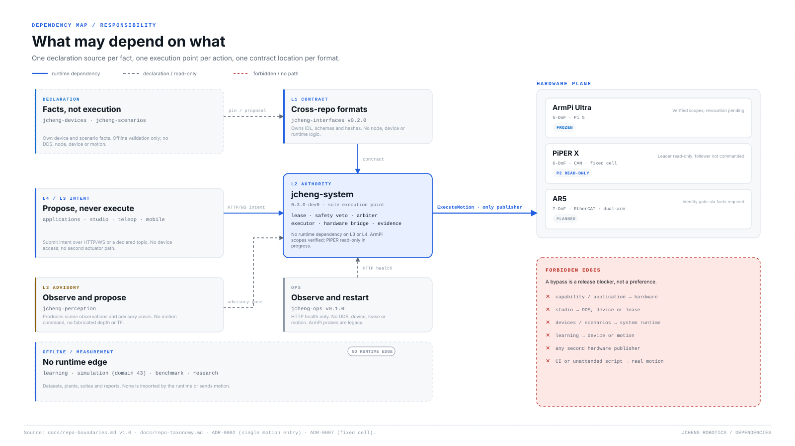
  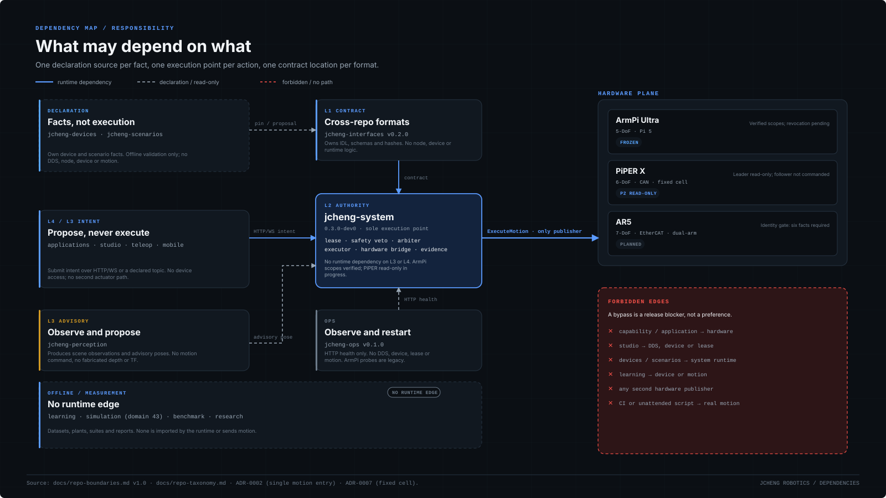
</p>
<p align="center"><sub><a href="https://raw.githubusercontent.com/JCHENG-Robotics/.github/main/profile/assets/dependencies-light.svg">Open full-size dependency graph</a></sub></p>

### The single motion path

<p align="center">
  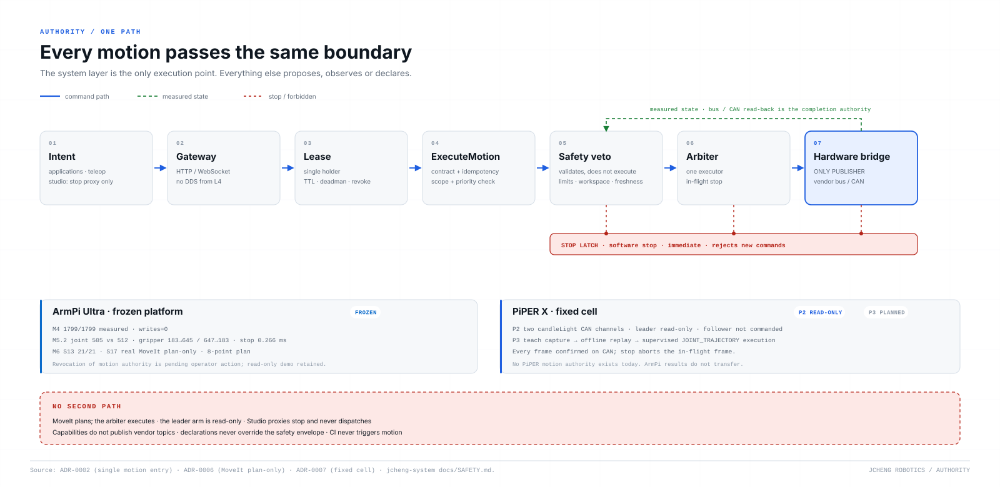
  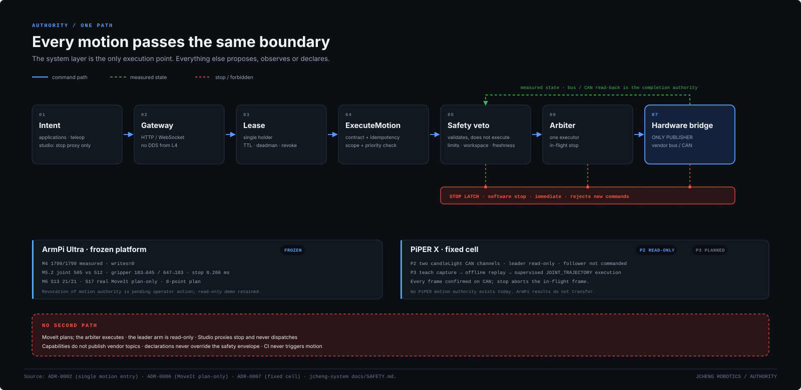
</p>
<p align="center"><sub><a href="https://raw.githubusercontent.com/JCHENG-Robotics/.github/main/profile/assets/motion-path-light.svg">Open full-size motion path</a></sub></p>

Intent becomes a command only inside `jcheng-system`: the gateway accepts HTTP/WS, the lease names one holder, `ExecuteMotion` checks the contract and idempotency, the safety supervisor vetoes, the arbiter executes, and the hardware bridge is the only publisher. Bus read-back — not cached `/joint_states` — is the completion authority. A stop request latches and rejects new commands; it is a software stop, not a safety-rated stop.

<details>
<summary><strong>Repository index</strong> — 16 repositories, their role and current state</summary>

| Repository | Layer | Role | State |
|---|---|---|---|
| [`.github`](https://github.com/JCHENG-Robotics/.github) | L0 | Governance, templates, reusable CI, ecosystem records | M1 complete; documentation standard v1.0 |
| [`jcheng-interfaces`](https://github.com/JCHENG-Robotics/jcheng-interfaces) | L1 | ROS IDL, HTTP/WS schemas, contract hashes | v0.3.0 released; v0.2.0 signed pin; 7/8 consumers |
| [`jcheng-system`](https://github.com/JCHENG-Robotics/jcheng-system) | L2 | Safety, authority, motion, hardware bridge, gateway | 0.3.0-dev0; ArmPi scopes verified; PiPER P2 read-only |
| [`jcheng-manipulation`](https://github.com/JCHENG-Robotics/jcheng-manipulation) | L3 | Frozen `v1.0.0` experimental baseline and evidence | Frozen; MIT; read-only reference |
| [`jcheng-mobile`](https://github.com/JCHENG-Robotics/jcheng-mobile) | L3 | Mobile base: laser odometry, SLAM, Nav2 intent | v0.1.0; static bring-up; dormant |
| [`jcheng-perception`](https://github.com/JCHENG-Robotics/jcheng-perception) | L3 | Distributed edge/GPU perception, advisory poses | v0.1.0; partial; one dual-view run |
| [`jcheng-learning`](https://github.com/JCHENG-Robotics/jcheng-learning) | L3 | Datasets, offline training and policy artifacts | v0.2.0; M1 offline infrastructure |
| [`jcheng-teleop`](https://github.com/JCHENG-Robotics/jcheng-teleop) | L3 | Operator input to bounded, lease-gated intent | v0.3.0; M0/M1 + mock intake; no hardware |
| [`jcheng-devices`](https://github.com/JCHENG-Robotics/jcheng-devices) | L3 | Declarative device and capability profiles | v0.1.0; 10 profiles / 7 capabilities; offline |
| [`jcheng-studio`](https://github.com/JCHENG-Robotics/jcheng-studio) | L4 | Operator console, sessions, replay, intent forwarding | v0.8.0; offline/mock verified; no hardware acceptance |
| [`jcheng-applications`](https://github.com/JCHENG-Robotics/jcheng-applications) | L4 | Recipe validation, deterministic planning, fail-closed intent | v0.1.0; M3 mock run; no hardware |
| [`jcheng-simulation`](https://github.com/JCHENG-Robotics/jcheng-simulation) | SIM | Multi-robot plant on domain 43 | v0.1.0; mock verified, Gazebo partial |
| [`jcheng-scenarios`](https://github.com/JCHENG-Robotics/jcheng-scenarios) | SCEN | Declarative scenario catalog and validation | v0.1.0; 8 schemas; offline only |
| [`jcheng-benchmark`](https://github.com/JCHENG-Robotics/jcheng-benchmark) | BENCH | Read-only benchmark harness and reports | v0.1.0; synthetic self-test; inconclusive |
| [`jcheng-ops`](https://github.com/JCHENG-Robotics/jcheng-ops) | OPS | Health checks, watchdog, service self-healing | v0.1.0; deployed on ArmPi; probes legacy |
| [`jcheng-research`](https://github.com/JCHENG-Robotics/jcheng-research) | RESEARCH | Literature, root cause, experiment design and reports | v0.1.0; draft reports; no product claim |

`jcheng-design`, `jcheng-system-r5`, `jcheng-system-v020` and `jcheng-ecosystem-bootstrap` are working checkouts or staging; `jcheng-mobile-bench` is a non-git bench sandbox. None is a repository in the runtime or release matrix.

</details>

## Core Capabilities

Status is scoped to the **strongest evidence**, not the intended use. A capability that has passed a mock test is not hardware-verified; a partial hardware run is not an acceptance.

| Capability | Repository | Version | Strongest evidence | Status |
|---|---|---|---|---|
| Manipulation baseline | `jcheng-manipulation` | 1.0.0 | L5 full G8 on ArmPi; intervention 24/24 in both paired trials | **Frozen baseline** |
| System runtime | `jcheng-system` | 0.3.0-dev0 | L5 M4/M5.2/S13/S17 on ArmPi; PiPER P2 read-only (no motion) | **Experimental · scoped hardware** |
| Contracts | `jcheng-interfaces` | 0.3.0 | v0.3.0 released; v0.2.0 signed pin still deployed by 7 consumers | **Verified contract · migration** |
| Perception | `jcheng-perception` | 0.1.0 | One dual-view run; S1 offline synthetic + public | **Experimental · partial** |
| Mobile base | `jcheng-mobile` | 0.1.0 | Static `/scan`, `/odom`, `/map` | **Experimental · dormant** |
| Learning | `jcheng-learning` | 0.2.0 | M1 dataset contract and LeRobot round-trip | **Experimental · offline** |
| Teleoperation | `jcheng-teleop` | 0.3.0 | M1 ROS-free core; mock/simulation L3 | **Experimental · offline** |
| Device library | `jcheng-devices` | 0.1.0 | 10 profiles / 7 capabilities; validator and CI | **Experimental · offline** |
| Scenario catalog | `jcheng-scenarios` | 0.1.0 | 8 schemas; `ore_sorting` reference | **Experimental · offline** |
| Simulation | `jcheng-simulation` | 0.1.0 | Domain 43; mock verified, Gazebo partial | **Experimental · offline** |
| Operator console | `jcheng-studio` | 0.8.0 | Read-only REST/WS, sessions, replay | **Experimental · no hardware** |
| Task orchestration | `jcheng-applications` | 0.1.0 | M3 mock run; 181 tests | **Experimental · no hardware** |
| Benchmark | `jcheng-benchmark` | 0.1.0 | Synthetic self-test; one migrated host snapshot | **Inconclusive** |
| Operations | `jcheng-ops` | 0.1.0 | Guards installed and verified; watchdog never fired | **Deployed · legacy** |
| Research | `jcheng-research` | 0.1.0 | Draft reports and unreviewed experiments | **Experimental · no product claim** |

### Data collection and robot learning

<p align="center">
  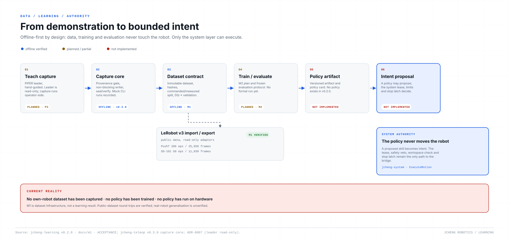
  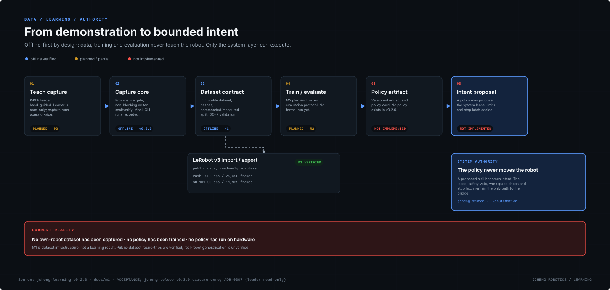
</p>
<p align="center"><sub><a href="https://raw.githubusercontent.com/JCHENG-Robotics/.github/main/profile/assets/learning-workflow-light.svg">Open full-size learning workflow</a></sub></p>

The path is offline-first: a hand-guided PiPER leader records demonstrations, the teleop capture core seals provenance, `jcheng-learning` validates an immutable dataset and round-trips LeRobot v3, and a policy may only **propose** intent. Training, policy artifacts and the hardware loop are not implemented. No own-robot dataset has been captured, and no policy has run on hardware.

## Hardware & Demonstrations

<p align="center">
  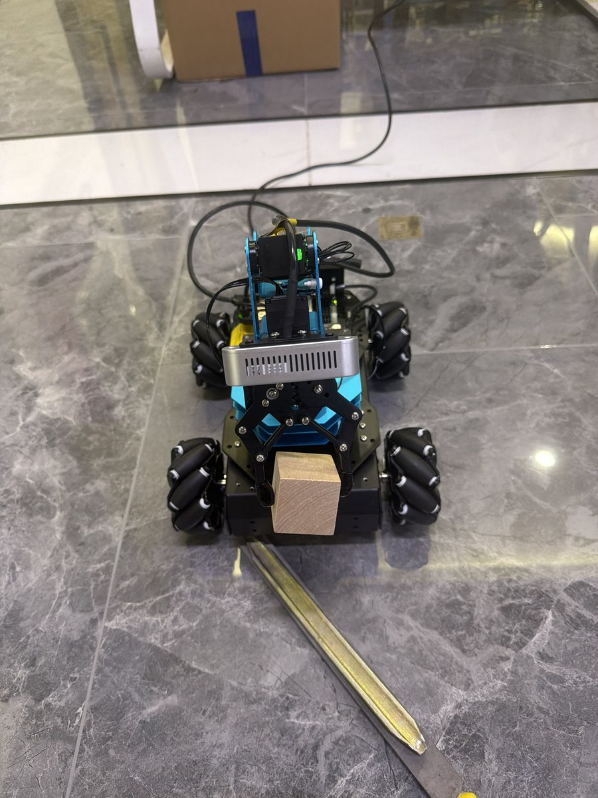
</p>
<p align="center"><sub><strong>ArmPi Ultra — first real grasp (2026-11-18).</strong> The arm holds a 39.4 mm wooden cube on the floor. The fully autonomous pick–lift–place followed on 2026-11-19.</sub></p>

| 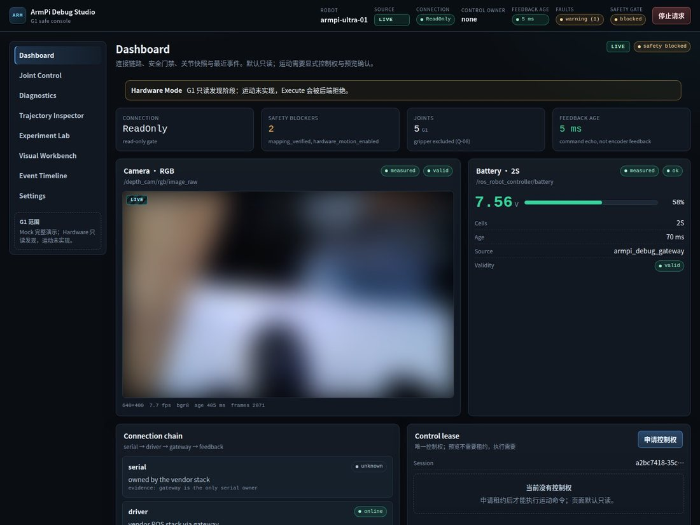 | 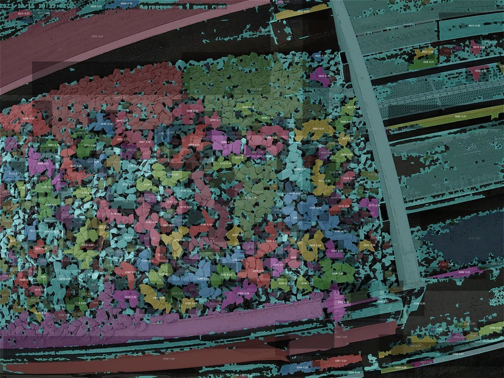 |
|---|---|
| **ArmPi Debug Studio (2026-11-18).** The frozen baseline console in read-only G1 scope; hardware motion is disabled and the page says so. | **Ore-scene S1 overlay (offline).** A qualitative overlay on the public Mendeley `40–70 mm` subset (CC BY 4.0). It is a domain-gap baseline, not real-ore accuracy. |
| **PiPER X fixed cell — no photo yet.** P2 has two CAN channels up, the leader/follower split recorded, and a read-only decoder. The follower is never commanded. | **What is not shown here.** There is no PiPER motion video, no AR5 hardware and no production cell. The absence is deliberate. |

**Asset entry points:** [baseline evidence index](https://github.com/JCHENG-Robotics/jcheng-manipulation/tree/main/evidence) · [ArmPi Debug Studio screenshots](https://github.com/JCHENG-Robotics/jcheng-manipulation/tree/main/evidence/studio_g5) · [perception hardware evidence](https://github.com/JCHENG-Robotics/jcheng-perception/tree/main/evidence) · [legacy 8-week Panda simulation](https://github.com/JCHENG-Robotics/jcheng-manipulation/blob/main/docs/demo.gif) (archived; not ArmPi hardware).

<sub>Ore overlay source: Mendeley Data, “benchmark for rock blasting”, `40_70mm` subset, CC BY 4.0. The overlay is generated offline by `jcheng-perception`; it is not a metric input.</sub>

## Experimental Evidence

<p align="center">
  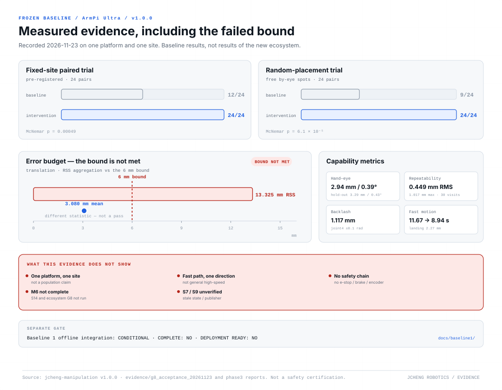
  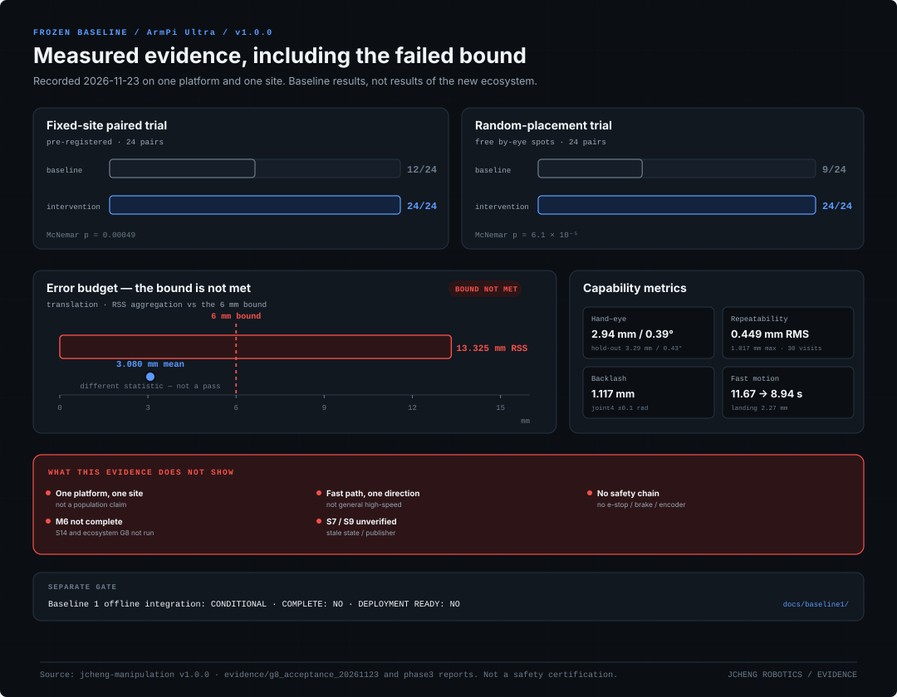
</p>
<p align="center"><sub><a href="https://raw.githubusercontent.com/JCHENG-Robotics/.github/main/profile/assets/evidence-light.svg">Open full-size evidence plate</a></sub></p>

| Evaluation | Reported result | Interpretation |
|---|---|---|
| Hand–eye calibration | 2.94 mm / 0.39° across 14 poses; hold-out 3.29 mm / 0.43° | Independent checkerboard validation, not vendor defaults |
| Fixed-site paired trial | 12/24 → **24/24**, McNemar p = 0.00049 | Constant low-configuration correction, pre-registered |
| Random-placement trial | 9/24 → **24/24**, McNemar p = 6.1 × 10⁻⁵ | Free placement, wrist/front-camera locate, base approach |
| Error budget | Translation RSS **13.325 mm** vs a 6 mm bound (fails); empirical placement mean **3.080 mm** | The bound is not met; the empirical mean is a different statistic |
| Fast motion | Grasp + put-back **11.67 s → 8.94 s**; G8 fast landing **2.27 mm** | S-curve 4.0 rad/s / 20 rad/s², bus-verified |
| Repeatability / backlash | 0.449 mm RMS / 1.017 mm max; backlash 1.117 mm | 30 visits; joint4 ±0.1 rad |

**Critical reading.** The 6 mm error-budget bound is **not** satisfied by the RSS aggregation. The reported placement mean is inside 6 mm, but that is a different statistic. The fast path was validated in one direction. None of these results constitutes a safety certification. The evidence comes from one platform, one site and a small number of supervised sessions.

**Separate gate.** Ecosystem Baseline 1 — the offline integration of the new repositories — has **technical acceptance PASS** (independent QA PASS WITH FINDINGS, P2 fixed). Formal completion awaits record #40 approval/merge: `BASELINE 1 COMPLETE: NO — pending #40`, `DEPLOYMENT READY: NO`. Its evidence is in [docs/baseline1/](https://github.com/JCHENG-Robotics/.github/blob/main/docs/baseline1/README.md); it is not a hardware result.

## Research & Development Roadmap

<p align="center">
  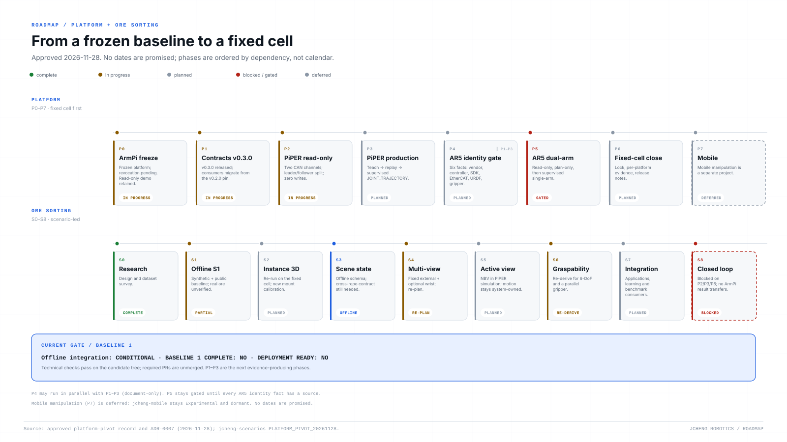
  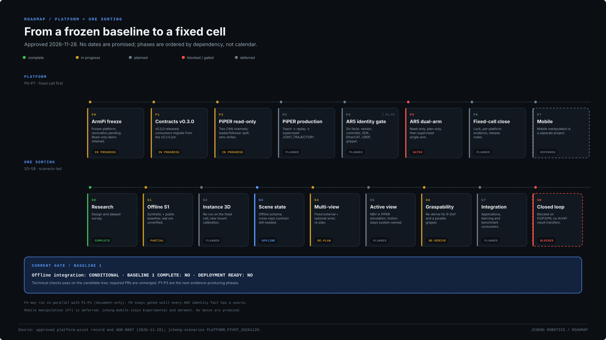
</p>
<p align="center"><sub><a href="https://raw.githubusercontent.com/JCHENG-Robotics/.github/main/profile/assets/roadmap-light.svg">Open full-size roadmap</a></sub></p>

The approved 2026-11-28 pivot freezes ArmPi Ultra and moves the platform to a **fixed cell**: PiPER X as the production execution arm, AR5 as a gated dual-arm successor, and mobile manipulation deferred to a separate P7 project.

- **Current gate:** Baseline 1 offline integration is conditional; deployment is not ready.
- **In progress:** P0 (ArmPi freeze and motion-authority revocation) and P2 (PiPER X read-only). P1 (contracts v0.3.0) is the next contract gate.
- **Ore sorting:** S0–S1 are offline; S1 is partially verified on synthetic and public data, with real-ore accuracy unverified. S8 closed-loop sorting is blocked on P2/P3/P6. No ArmPi result transfers.

No dates are promised. Phases are ordered by dependency, not calendar. See [docs/platform-transition.md](https://github.com/JCHENG-Robotics/.github/blob/main/docs/platform-transition.md) for the phase table, the ArmPi freeze record and the AR5 identity gate.

<details>
<summary><strong>Phase index</strong> — scope, state and exit evidence</summary>

| Phase | Scope | State | Exit evidence |
|---|---|---|---|
| **P0** | ArmPi Ultra freeze; motion-authority revocation | **In progress** | Freeze record; read-only demo; publisher set recorded |
| **P1** | Contracts v0.3.0: robot-profile v2, `chain_id`, gripper ranges | **Planned** | v1/v2 load; all gates green; mock runs a v2 profile |
| **P2** | PiPER X read-only: two CAN channels, zero writes | **In progress** | 30 min read-only; `writes=0`; SDK agreement |
| **P3** | PiPER X production: teach → replay → supervised execution | **Planned** | One pick-place; per-frame CAN confirmation; stop ≤100 ms |
| **P4** | AR5 identity gate: six facts | **Planned** (parallel with P1–P3) | Every fact sourced or explicitly unknown |
| **P5** | AR5 read-only and dual-arm | **Gated** | Dual-arm read-only; plan-only; single-arm L5 |
| **P6** | Fixed-cell close: lock, evidence, release notes | **Planned** | Per-platform evidence and a new lock |
| **P7** | Mobile manipulation | **Deferred** | Separate project charter |

| Ore stage | Scope | State |
|---|---|---|
| **S0** | Research and dataset survey | **Complete** |
| **S1** | Offline segmentation, synthetic + public baseline | **Partial** — real-ore accuracy unverified |
| **S2–S7** | 3D geometry, scene state, multi-view, active view, graspability, integration | **Planned / re-plan** on the fixed cell |
| **S8** | Closed-loop sorting | **Blocked** on P2/P3/P6 |

</details>


## Developer Resources

| Start here | Build and test | Contribute | Governance |
|---|---|---|---|
| [Ecosystem roadmap](https://github.com/JCHENG-Robotics/.github/blob/main/ROADMAP.md) | [Baseline 1 acceptance script](https://github.com/JCHENG-Robotics/.github/blob/main/dev/baseline1-acceptance.sh) | [Contributing](https://github.com/JCHENG-Robotics/.github/blob/main/CONTRIBUTING.md) | [Repository boundaries](https://github.com/JCHENG-Robotics/.github/blob/main/docs/repo-boundaries.md) |
| [Acceptance report](https://github.com/JCHENG-Robotics/.github/blob/main/ACCEPTANCE.md) | `jcheng-system` mock stack (no hardware) | [Code of conduct](https://github.com/JCHENG-Robotics/.github/blob/main/CODE_OF_CONDUCT.md) | [Documentation standard](https://github.com/JCHENG-Robotics/.github/blob/main/docs/documentation-standard.md) |
| [Baseline 1 record](https://github.com/JCHENG-Robotics/.github/blob/main/docs/baseline1/README.md) | `jcheng-learning` dataset CLI (offline) | [Security policy](https://github.com/JCHENG-Robotics/.github/blob/main/SECURITY.md) | [Repository taxonomy](https://github.com/JCHENG-Robotics/.github/blob/main/docs/repo-taxonomy.md) |
| [Architecture](https://github.com/JCHENG-Robotics/.github/blob/main/docs/architecture.md) · [Evidence](https://github.com/JCHENG-Robotics/.github/blob/main/docs/evidence.md) · [Safety](https://github.com/JCHENG-Robotics/.github/blob/main/docs/safety-and-limitations.md) | ROS 2 Humble (robot) / Jazzy (host); Python 3.12 | Issue and design templates | [Governance](https://github.com/JCHENG-Robotics/.github/blob/main/GOVERNANCE.md) |

## Safety, Limitations & Governance

### Safety model and non-claims

The platform has **no hardware e-stop, brake, independent encoder, torque sensing or self-collision model**. The base is open-loop with no odometry. A software stop is a hold/zero command, not a safety-rated stop. The ecosystem is **not safety-certified** and claims no SIL/PL compliance.

- All real-robot work is supervised and requires **separate, explicit authorization** per session.
- The UI and documentation say “software stop” or “stop request”, never “emergency stop”.
- Vendor container restarts can move the arm (`startup_check`); the system does not restart the vendor container automatically.
- The ArmPi platform is frozen. Motion-authority revocation is **pending operator action**; the read-only gateway and rollback path are retained.

### Limitations and threats to validity

- **Single platform and site.** Results come from one ArmPi Ultra, one table setup and a small number of supervised sessions.
- **Failed bound.** The 6 mm RSS error-budget bound is not met; the 3.080 mm placement mean is a different statistic.
- **Fast path scope.** The 4.0/20 profile is bus-verified but was validated in one direction.
- **M6 not complete.** S14 and the ecosystem G8 re-run were never started; the platform freeze retires them, not defers them. The baseline’s own full G8 is a separate, frozen result.
- **Residual unverified items.** S7 stale-state injection and S9 runtime publisher detection remain unverified.
- **Partial capabilities.** Mobile has only a static bring-up and is dormant; perception has one dual-view run and a wrist depth reader that can still wedge; benchmark has no suite result; ops has never fired its watchdog in a real wedge.
- **License status.** The frozen baseline and `jcheng-mobile` carry MIT (mobile retained pending review). **14 repositories — including this one — have no `LICENSE`** and grant no reuse until the review closes. See [license status](https://github.com/JCHENG-Robotics/.github/blob/main/docs/safety-and-limitations.md#8-license-status).

### Governance

`main` is protected on every repository: pull request, independent review, CODEOWNERS, linear history, no force-push or deletion, and an organization merge queue. A second reviewer (`@JerichoSwaine`) holds maintain access and is a CODEOWNER. Security reports follow [`SECURITY.md`](https://github.com/JCHENG-Robotics/.github/blob/main/SECURITY.md); do not disclose exploit details or credentials publicly.

## Citation & Contact

If you reference the experimental baseline, please cite:

```bibtex
@software{jcheng_manipulation_2026,
  author  = {Cheng, Kewei (Jericho)},
  title   = {JCHENG Manipulation: A ROS 2-Based Robotic Manipulation System with Quantitative Reliability Evaluation},
  year    = {2026},
  version = {1.0.0},
  url     = {https://github.com/JCHENG-Robotics/jcheng-manipulation}
}
```

- **Design and contract questions:** open a `design` issue in the relevant repository.
- **Security:** follow `SECURITY.md`; do not open a public exploit issue.
- **Real-robot work:** coordinated with the operator; no remote motion requests.

The baseline evidence index, failure taxonomy and full experimental record remain the authoritative reference for the platform’s measured behaviour.
