# JCHENG Robotics

**简体中文** | [English](https://github.com/JCHENG-Robotics/.github/blob/main/profile/README.md)

<p align="center">
  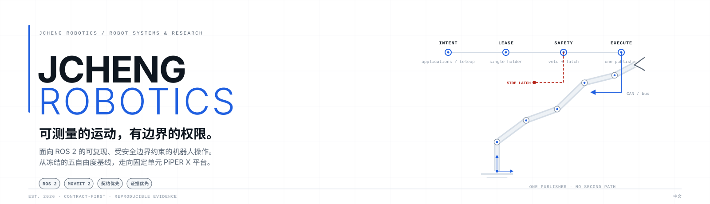
  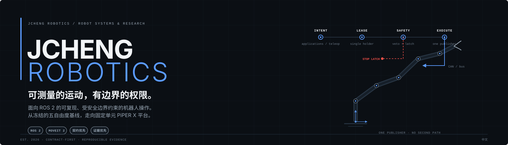
</p>

**可复现、受安全边界约束的机器人操作。**  
一个以实测运动、明确契约与可审计证据为核心的工程组织 —— 从冻结的五自由度基线，走向固定单元 PiPER X 平台。

**状态数据：** 2026-11-28 · **冻结基线：** `jcheng-manipulation v1.0.0` · **部署：** 未就绪<br>
**从这里开始：** [当前状态](#当前状态) · [生态架构](#生态架构) · [实验证据](#实验证据) · [路线图](#研发路线图) · [开发者资源](#开发者资源)

---

## 项目概览

JCHENG Robotics 构建的机器人操作系统，要求每一项结论都能追溯到证据。工作始于低成本五自由度 ArmPi Ultra 上的一项长期个人发展项目，现已发展为一个独立版本化的生态：契约、特权运行时、能力模块、操作工具、仿真、基准与治理。

两条规则始终未变：

1. **每个结论都可追溯。** 结果附有命令、日志、数据或机器可读报告；未测量的量会明确标注。
2. **每个实机运动都经过同一道边界。** 运动意图先经过校验与仲裁，之后才允许发布硬件命令；任何模块都不会获得第二条通往执行器的路径。

| 这是 | 这不是 |
|---|---|
| 一个研究级工程作品集，以及可运行的离线 / Mock 生态 | 经过认证的安全系统、生产部署或通用机器人平台 |
| 一个冻结基线，以及单台 ArmPi Ultra 上范围明确的硬件证据 | 总体可靠性结论，或可迁移到 PiPER X / AR5 的证据 |
| 一个契约与证据等级明确的离线优先生态 | 已完成的 v1.0 生态：基线 1 技术已完成，但正式完成待 #40，部署未就绪 |

## 工程要点

| | |
|---|---|
| **单一运动权威。** `jcheng-system` 拥有租约、安全否决、仲裁、执行与唯一的硬件发布者。MoveIt 只规划，仲裁器负责执行。 | **契约优先。** `jcheng-interfaces` 于 2026-11-28 发布 v0.3.0 多链契约；已签名的 v0.2.0 仍是 7/8 运行时消费方的部署 pin，迁移进行中；感知仓有明确豁免。 |
| **先证据，后结论。** 基线同时报告未通过的 6 mm 误差预算门限，以及 3.080 mm 的实测放置均值 —— 后者是另一个统计量，不是通过。 | **实测，而非假设。** 14 位姿手眼标定（2.94 mm / 0.39°）、0.449 mm RMS 重复性、1.117 mm 回差、总线确认的运动。 |
| **平台转向。** ArmPi Ultra 于 2026-11-28 冻结。后继平台是固定单元 PiPER X；AR5 需通过六项身份事实门禁；移动化推迟。 | **默认离线。** 设备、场景、仿真、学习、基准与调研只做声明或测量，从不执行。 |

## 当前状态

> **验证按平台限定。** ArmPi 的结果不会迁移到 PiPER X 或 AR5。`硬件已验证` 指指定范围在指定平台上通过 —— 不代表仓库或整个生态已可部署。

| 领域 | 状态 | 证据 / 下一步 |
|---|---|---|
| **冻结基线** | **Frozen** —— `jcheng-manipulation v1.0.0` @ `b3411e4`；MIT；基线完整 G8 记录于 2026-11-23 | 单台 ArmPi Ultra 上的范围限定 L5 硬件证据；平台整体从未做过端到端验证。[证据](#实验证据) |
| **平台** | **ArmPi Ultra：Frozen**（2026-11-28）· **PiPER X：P2 只读进行中** · **AR5：计划中 / 身份门禁** | 转向已批准；冻结记录的发布仍在进行。[平台转向](https://github.com/JCHENG-Robotics/.github/blob/main/docs/platform-transition.md) |
| **生态基线 1** | **离线集成：技术验收 PASS；正式 COMPLETE 待记录 #40 批准/合并** | `BASELINE 1 COMPLETE: NO — 待 #40` · `DEPLOYMENT READY: NO`。[记录](https://github.com/JCHENG-Robotics/.github/blob/main/docs/baseline1/README.md) |
| **契约** | `jcheng-interfaces v0.3.0` 于 2026-11-28 发布（robot-profile v2、`chain_id`、夹爪单位）；**v0.2.0 仍是已签名的部署 pin**，7/8 消费方；迁移进行中 | 基线 1 使用 v0.2.0 记录；感知仓固定在 `>=0.1,<0.2`，并有已记录豁免。[契约仓](https://github.com/JCHENG-Robotics/jcheng-interfaces) |
| **运行时** | `jcheng-system 0.3.0-dev0` —— 14 个 ROS 包；ArmPi M4/M5.2/S13/S17 已验证；PiPER 只读后端已实现 | 无 PiPER 运动；无生产部署。[系统仓](https://github.com/JCHENG-Robotics/jcheng-system) |
| **能力** | 感知、移动、学习、遥操作、设备、场景、仿真、操作台、任务编排 —— **实验性** | 每个仓库的最强证据见[能力矩阵](#核心能力)。 |
| **部署** | **未就绪** —— 无跨进程租约源、无底盘硬件桥、DDS 权威未基于证书 | 这不是生产系统。 |
| **安全** | **未认证。** 无急停、抱闸、独立编码器、力矩感知或自碰撞模型 | 软件停止是保持 / 零指令，不是安全等级停止。 |

**状态词表：** `Frozen` · `Hardware verified` · `Offline verified` · `Experimental` · `Planned` · `Dormant` · `Conditional` · `Not ready`。定义与证据等级见 [docs/evidence.md](https://github.com/JCHENG-Robotics/.github/blob/main/docs/evidence.md#2-status-vocabulary)。

## 生态架构

<p align="center">
  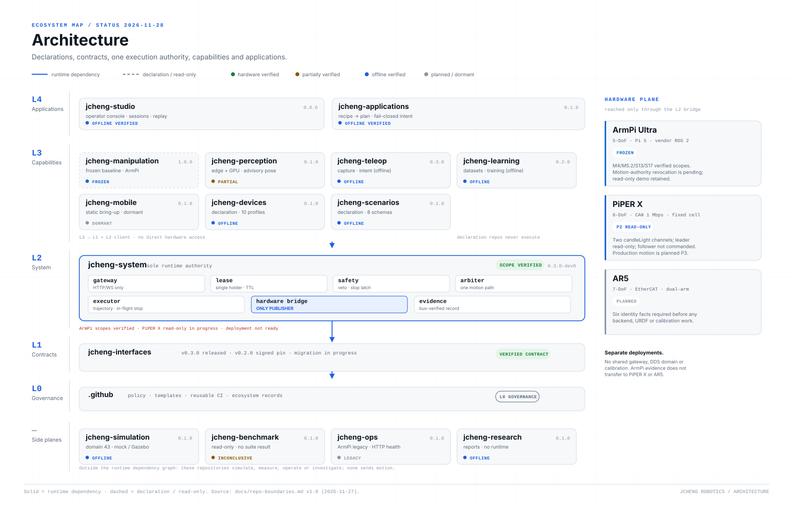
  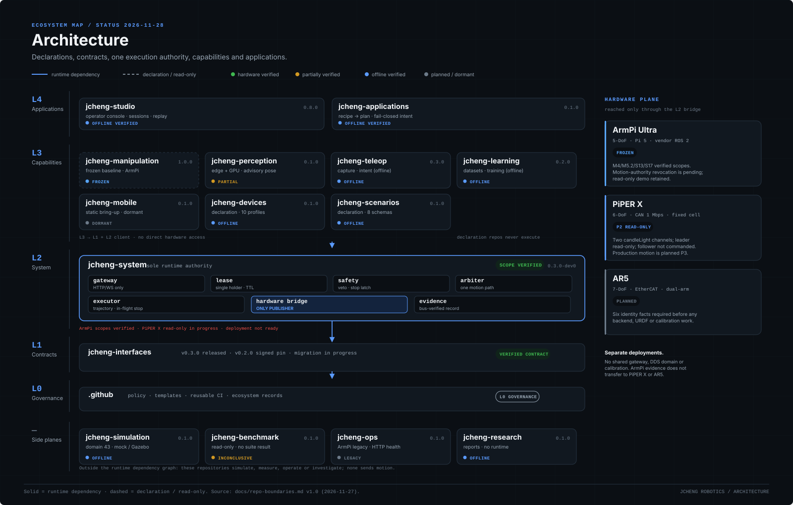
</p>
<p align="center"><sub><a href="https://raw.githubusercontent.com/JCHENG-Robotics/.github/main/profile/assets/architecture-light.svg">打开全尺寸架构图</a></sub></p>

架构把**声明**、**契约**、**特权执行**、**能力**与**应用**分开。只有 L2 发布运动。

| 层 | 仓库 | 职责 |
|---|---|---|
| **L0 治理** | `.github` | 策略、模板、复用 CI、生态记录 |
| **L1 契约** | `jcheng-interfaces` | ROS IDL、HTTP/WS Schema、契约哈希 |
| **L2 系统** | `jcheng-system` | 安全、租约、仲裁、执行、硬件桥、网关 |
| **L3 能力** | `jcheng-manipulation`（冻结）、`jcheng-perception`、`jcheng-teleop`、`jcheng-learning`、`jcheng-devices`、`jcheng-mobile`（休眠） | 感知、意图、学习、设备声明 |
| **L4 应用** | `jcheng-studio`、`jcheng-applications` | 操作台、任务编排 |
| **侧翼平面** | `jcheng-simulation`、`jcheng-scenarios`、`jcheng-benchmark`、`jcheng-ops`、`jcheng-research` | 仿真、声明、测量、运维、调研 |

**依赖方向：** L4 → L2 API；L3 → L1 + L2 客户端；L2 → L1；L0 → 所有（仅 CI）。声明类仓库不在运行时依赖图中。声明不能覆盖系统安全包络；出现不一致即为发布阻断，而不是偏好问题。

<p align="center">
  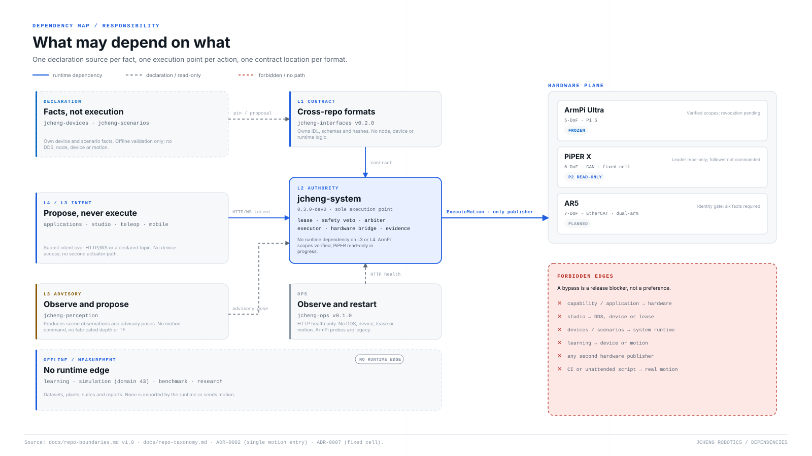
  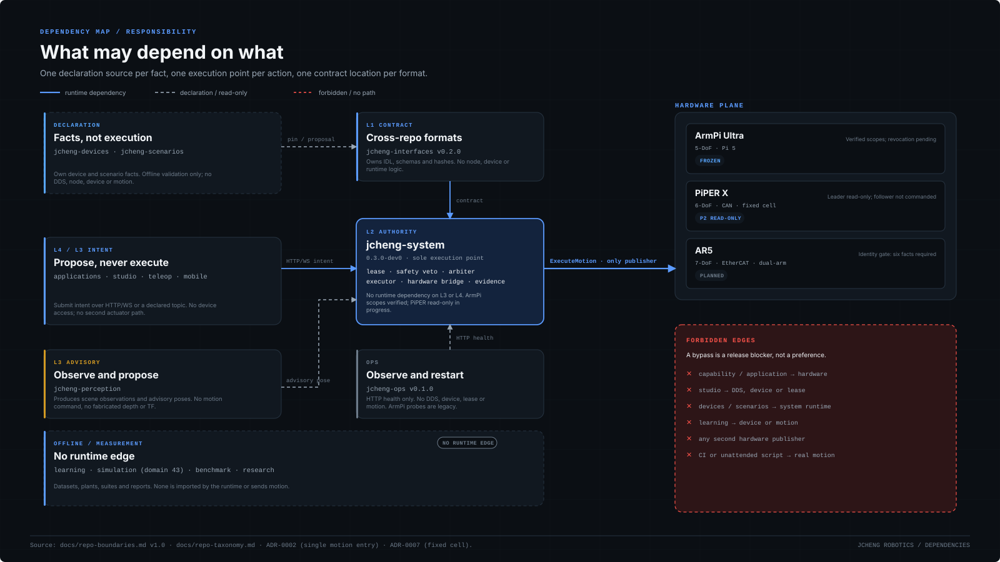
</p>
<p align="center"><sub><a href="https://raw.githubusercontent.com/JCHENG-Robotics/.github/main/profile/assets/dependencies-light.svg">打开全尺寸依赖图</a></sub></p>

### 单一运动路径

<p align="center">
  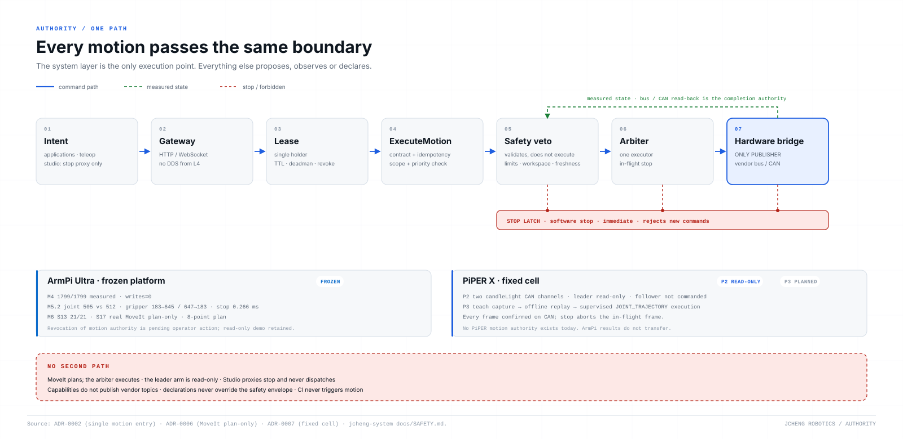
  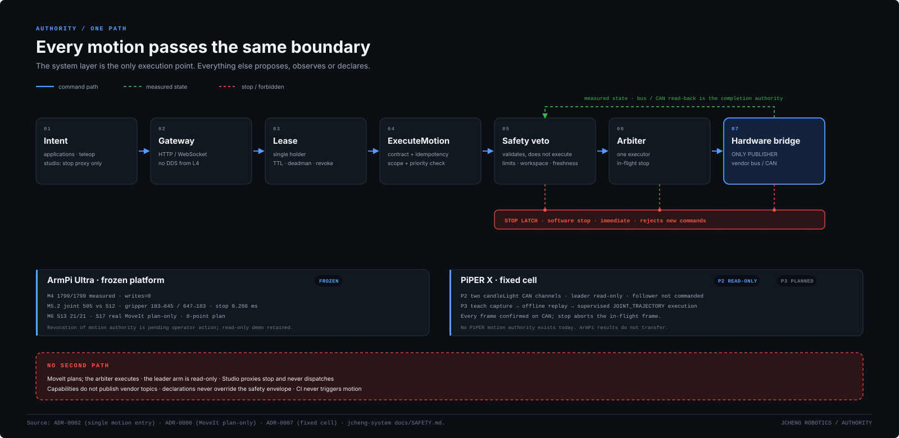
</p>
<p align="center"><sub><a href="https://raw.githubusercontent.com/JCHENG-Robotics/.github/main/profile/assets/motion-path-light.svg">打开全尺寸运动路径图</a></sub></p>

意图只有在 `jcheng-system` 内部才会变成命令：网关接受 HTTP/WS，租约指定唯一持有者，`ExecuteMotion` 检查契约与幂等性，安全监督器否决，仲裁器执行，硬件桥是唯一发布者。完成判定以总线读回为准，而不是缓存的 `/joint_states`。停止请求会锁存并拒绝新命令；它是软件停止，不是安全等级停止。

<details>
<summary><strong>仓库索引</strong> —— 16 个仓库的职责与当前状态</summary>

| 仓库 | 层 | 职责 | 状态 |
|---|---|---|---|
| [`.github`](https://github.com/JCHENG-Robotics/.github) | L0 | 治理、模板、复用 CI、生态记录 | M1 完成；文档标准 v1.0 |
| [`jcheng-interfaces`](https://github.com/JCHENG-Robotics/jcheng-interfaces) | L1 | ROS IDL、HTTP/WS Schema、契约哈希 | v0.3.0 已发布；v0.2.0 签名 pin；7/8 消费方 |
| [`jcheng-system`](https://github.com/JCHENG-Robotics/jcheng-system) | L2 | 安全、权威、运动、硬件桥、网关 | 0.3.0-dev0；ArmPi 范围已验证；PiPER P2 只读 |
| [`jcheng-manipulation`](https://github.com/JCHENG-Robotics/jcheng-manipulation) | L3 | 冻结的 `v1.0.0` 实验基线与证据 | 冻结；MIT；只读参考 |
| [`jcheng-mobile`](https://github.com/JCHENG-Robotics/jcheng-mobile) | L3 | 移动底盘：激光里程计、SLAM、Nav2 意图 | v0.1.0；静态启动；休眠 |
| [`jcheng-perception`](https://github.com/JCHENG-Robotics/jcheng-perception) | L3 | 边云分布式感知、建议位姿 | v0.1.0；部分验证；单次双视图 |
| [`jcheng-learning`](https://github.com/JCHENG-Robotics/jcheng-learning) | L3 | 数据集、离线训练与策略产物 | v0.2.0；M1 离线基础设施 |
| [`jcheng-teleop`](https://github.com/JCHENG-Robotics/jcheng-teleop) | L3 | 操作员输入到有界、租约门控的意图 | v0.3.0；M0/M1 + Mock 接入；无硬件 |
| [`jcheng-devices`](https://github.com/JCHENG-Robotics/jcheng-devices) | L3 | 声明式设备与能力描述 | v0.1.0；10 个设备 / 7 个能力；离线 |
| [`jcheng-studio`](https://github.com/JCHENG-Robotics/jcheng-studio) | L4 | 操作台、会话、回放、意图转发 | v0.8.0；离线 / Mock 验证；无硬件验收 |
| [`jcheng-applications`](https://github.com/JCHENG-Robotics/jcheng-applications) | L4 | 配方校验、确定性规划、失败关闭意图 | v0.1.0；M3 Mock 运行；无硬件 |
| [`jcheng-simulation`](https://github.com/JCHENG-Robotics/jcheng-simulation) | SIM | 域 43 上的多机器人被控对象 | v0.1.0；Mock 已验证，Gazebo 部分 |
| [`jcheng-scenarios`](https://github.com/JCHENG-Robotics/jcheng-scenarios) | SCEN | 声明式场景库与校验 | v0.1.0；8 个 Schema；仅离线 |
| [`jcheng-benchmark`](https://github.com/JCHENG-Robotics/jcheng-benchmark) | BENCH | 只读基准框架与报告 | v0.1.0；合成自测；结论不确定 |
| [`jcheng-ops`](https://github.com/JCHENG-Robotics/jcheng-ops) | OPS | 健康检查、看门狗、服务自愈 | v0.1.0；ArmPi 已部署；探针为 legacy |
| [`jcheng-research`](https://github.com/JCHENG-Robotics/jcheng-research) | RESEARCH | 文献、根因、实验设计与报告 | v0.1.0；草稿报告；无产品结论 |

`jcheng-design`、`jcheng-system-r5`、`jcheng-system-v020` 与 `jcheng-ecosystem-bootstrap` 是工作检出或暂存目录；`jcheng-mobile-bench` 是非 git 台架沙箱。它们都不属于运行时或发布矩阵中的仓库。

</details>

## 核心能力

状态以**最强证据**为准，而不是预期用途。通过 Mock 测试不等于硬件验证；部分硬件运行不等于验收。

| 能力 | 仓库 | 版本 | 最强证据 | 状态 |
|---|---|---|---|---|
| 操作基线 | `jcheng-manipulation` | 1.0.0 | ArmPi 上 L5 完整 G8；两组配对试验干预均为 24/24 | **冻结基线** |
| 系统运行时 | `jcheng-system` | 0.3.0-dev0 | ArmPi 上 L5 M4/M5.2/S13/S17；PiPER P2 只读（无运动） | **实验性 · 范围硬件验证** |
| 契约 | `jcheng-interfaces` | 0.3.0 | v0.3.0 已发布；v0.2.0 签名 pin 仍服务 7 个消费方 | **契约已验证 · 迁移中** |
| 感知 | `jcheng-perception` | 0.1.0 | 单次双视图；S1 离线合成 + 公开数据 | **实验性 · 部分** |
| 移动底盘 | `jcheng-mobile` | 0.1.0 | 静态 `/scan`、`/odom`、`/map` | **实验性 · 休眠** |
| 学习 | `jcheng-learning` | 0.2.0 | M1 数据集契约与 LeRobot 往返 | **实验性 · 离线** |
| 遥操作 | `jcheng-teleop` | 0.3.0 | M1 ROS-free 核心；Mock / 仿真 L3 | **实验性 · 离线** |
| 设备库 | `jcheng-devices` | 0.1.0 | 10 个设备 / 7 个能力；校验器与 CI | **实验性 · 离线** |
| 场景库 | `jcheng-scenarios` | 0.1.0 | 8 个 Schema；`ore_sorting` 参考场景 | **实验性 · 离线** |
| 仿真 | `jcheng-simulation` | 0.1.0 | 域 43；Mock 已验证，Gazebo 部分 | **实验性 · 离线** |
| 操作台 | `jcheng-studio` | 0.8.0 | 只读 REST/WS、会话、回放 | **实验性 · 无硬件** |
| 任务编排 | `jcheng-applications` | 0.1.0 | M3 Mock 运行；181 项测试 | **实验性 · 无硬件** |
| 基准 | `jcheng-benchmark` | 0.1.0 | 合成自测；一次迁移的主机快照 | **结论不确定** |
| 运维 | `jcheng-ops` | 0.1.0 | 守护已安装并验证；看门狗从未真实触发 | **已部署 · legacy** |
| 调研 | `jcheng-research` | 0.1.0 | 草稿报告与未评审实验 | **实验性 · 无产品结论** |

### 数据采集与机器人学习

<p align="center">
  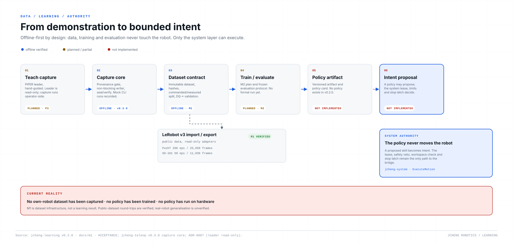
  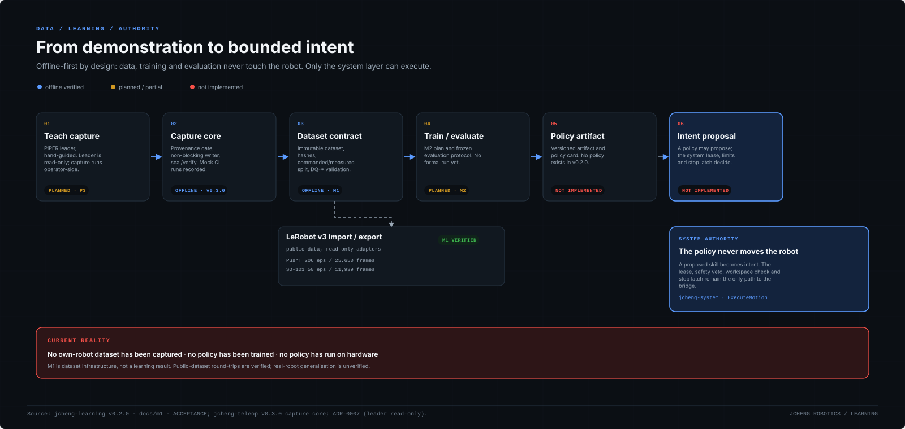
</p>
<p align="center"><sub><a href="https://raw.githubusercontent.com/JCHENG-Robotics/.github/main/profile/assets/learning-workflow-light.svg">打开全尺寸学习工作流</a></sub></p>

路径默认离线：手扶 PiPER leader 录制示教，遥操作采集核心封存 provenance，`jcheng-learning` 校验不可变数据集并完成 LeRobot v3 往返，策略只能**提议**意图。训练、策略产物与硬件闭环尚未实现。尚未采集自有机器人数据集，也没有任何策略在硬件上运行。

## 硬件与演示

<p align="center">
  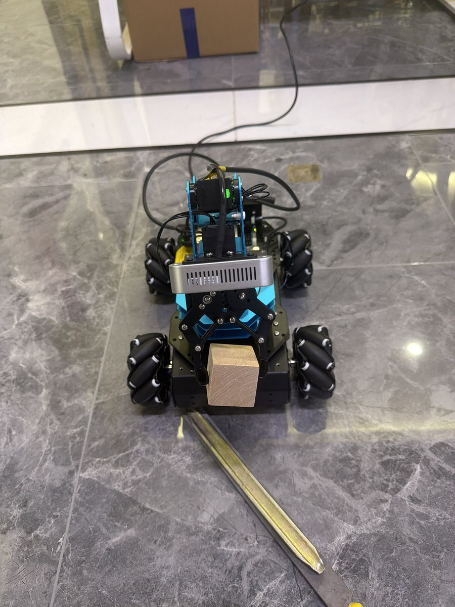
</p>
<p align="center"><sub><strong>ArmPi Ultra —— 首次实机抓取（2026-11-18）。</strong> 机械臂在地面上夹持 39.4 mm 木块；完整自主抓取—抬升—放置于 2026-11-19 完成。</sub></p>

| 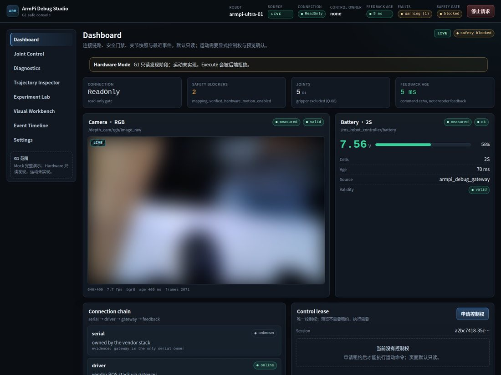 | 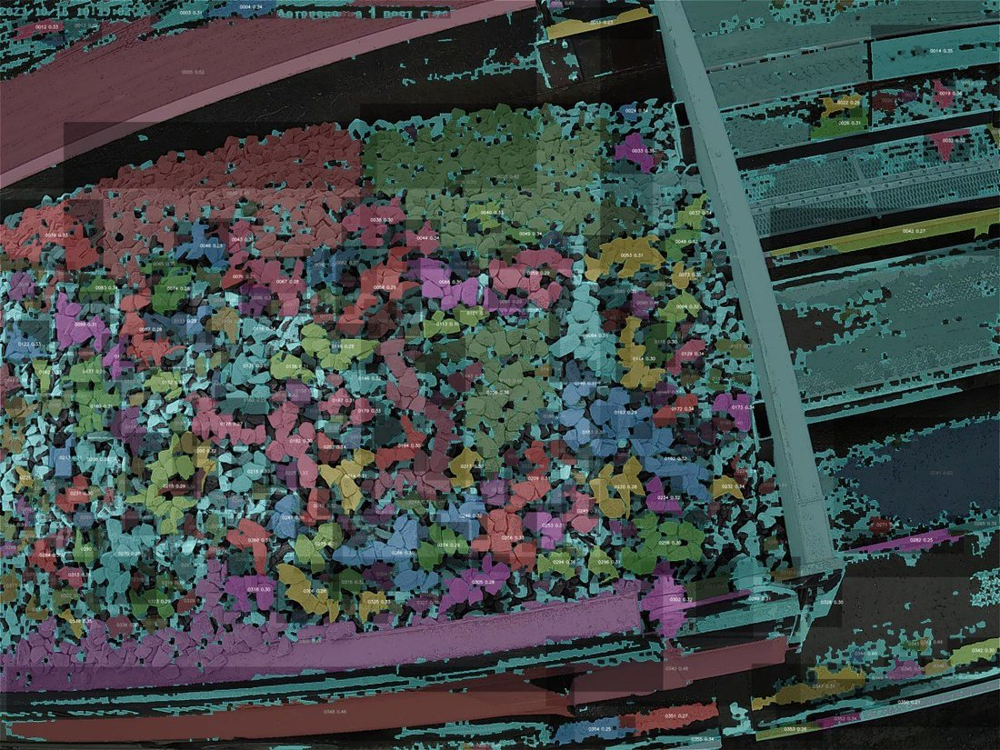 |
|---|---|
| **ArmPi Debug Studio（2026-11-18）。** 冻结基线的操作台，处于只读 G1 范围；硬件运动被禁用，页面明确标注。 | **矿石场景 S1 叠加（离线）。** 在公开 Mendeley `40–70 mm` 子集（CC BY 4.0）上的定性叠加；这是域差基线，不是真实矿石精度。 |
| **PiPER X 固定单元 —— 尚无照片。** P2 已接通两路 CAN，记录 leader/follower 分工，并有只读解码器；follower 从未被下发指令。 | **这里没有展示的内容。** 没有 PiPER 运动视频、没有 AR5 硬件、没有生产单元。这种缺失是刻意的。 |

**资产入口：** [基线证据索引](https://github.com/JCHENG-Robotics/jcheng-manipulation/tree/main/evidence) · [ArmPi Debug Studio 截图](https://github.com/JCHENG-Robotics/jcheng-manipulation/tree/main/evidence/studio_g5) · [感知硬件证据](https://github.com/JCHENG-Robotics/jcheng-perception/tree/main/evidence) · [早期 8 周 Panda 仿真](https://github.com/JCHENG-Robotics/jcheng-manipulation/blob/main/docs/demo.gif)（归档；不是 ArmPi 硬件）。

<sub>矿石叠加来源：Mendeley Data，“benchmark for rock blasting”，`40_70mm` 子集，CC BY 4.0。叠加由 `jcheng-perception` 离线生成，不作为指标输入。</sub>

## 实验证据

<p align="center">
  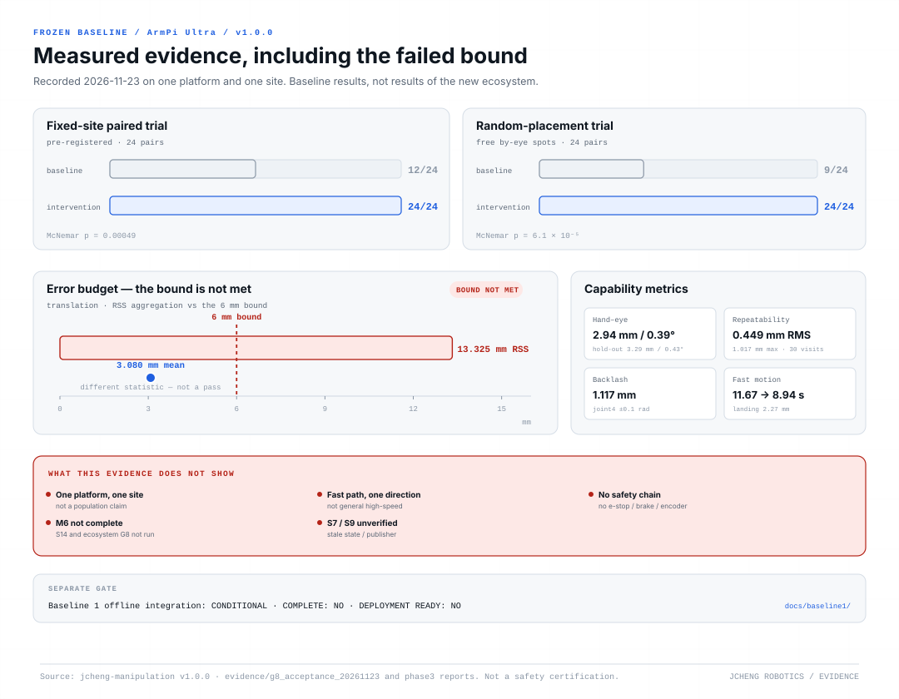
  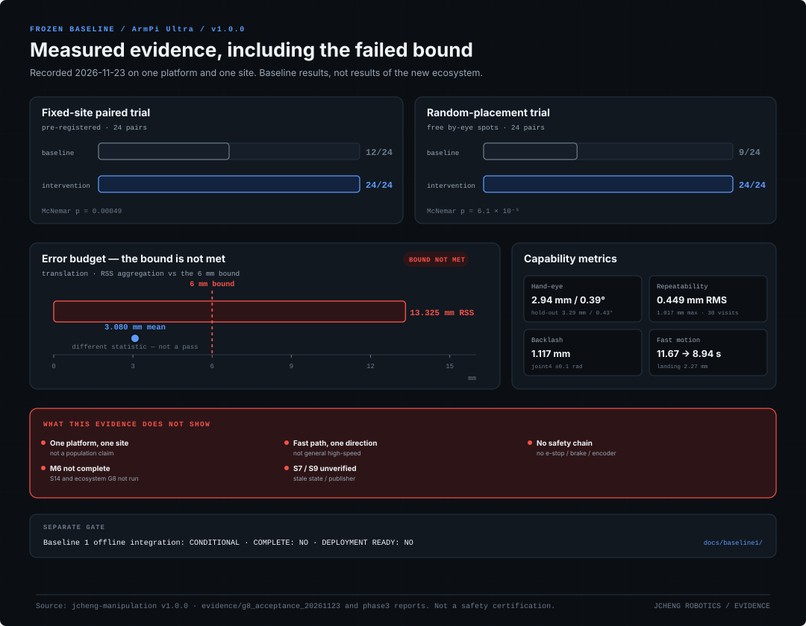
</p>
<p align="center"><sub><a href="https://raw.githubusercontent.com/JCHENG-Robotics/.github/main/profile/assets/evidence-light.svg">打开全尺寸证据图</a></sub></p>

| 评估 | 报告结果 | 解读 |
|---|---|---|
| 手眼标定 | 14 个位姿 2.94 mm / 0.39°；留出 3.29 mm / 0.43° | 独立棋盘格验证，不依赖厂商默认值 |
| 固定点配对试验 | 12/24 → **24/24**，McNemar p = 0.00049 | 预注册的低构型常数修正 |
| 随机落点试验 | 9/24 → **24/24**，McNemar p = 6.1 × 10⁻⁵ | 自由摆放、腕部 / 前视相机定位、底盘接近 |
| 误差预算 | 平移 RSS **13.325 mm**，6 mm 门限未通过；实测放置均值 **3.080 mm** | 门限未满足；实测均值是另一个统计量 |
| 快速运动 | 抓取 + 放回 **11.67 s → 8.94 s**；G8 快路径落点 **2.27 mm** | S 曲线 4.0 rad/s / 20 rad/s²，总线确认 |
| 重复性 / 回差 | 0.449 mm RMS / 1.017 mm max；回差 1.117 mm | 30 次访问；joint4 ±0.1 rad |

**批判性解读。** RSS 聚合**没有**满足 6 mm 误差预算门限。报告的放置均值在 6 mm 内，但那是不同的统计量。快速路径只在一个方向上完成验证。以上结果都不构成安全认证。证据来自一台平台、一个场地和少量受监督会话。

**独立门禁。** 生态基线 1 —— 新仓库的离线集成 —— **技术验收 PASS**（独立 QA PASS WITH FINDINGS，P2 已修复）。正式完成待记录 #40 批准/合并：`BASELINE 1 COMPLETE: NO — 待 #40`、`DEPLOYMENT READY: NO`。其证据在 [docs/baseline1/](https://github.com/JCHENG-Robotics/.github/blob/main/docs/baseline1/README.md)，不是硬件结果。

## 研发路线图

<p align="center">
  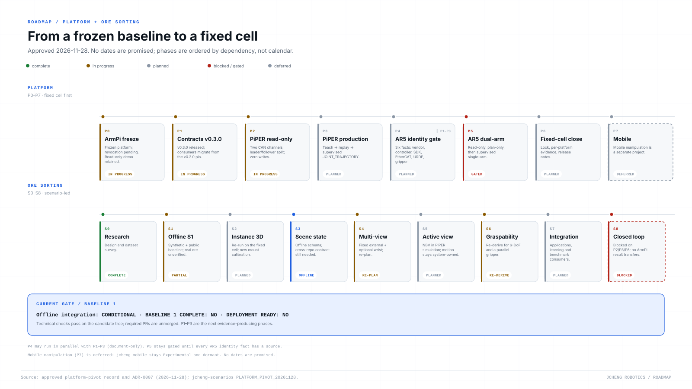
  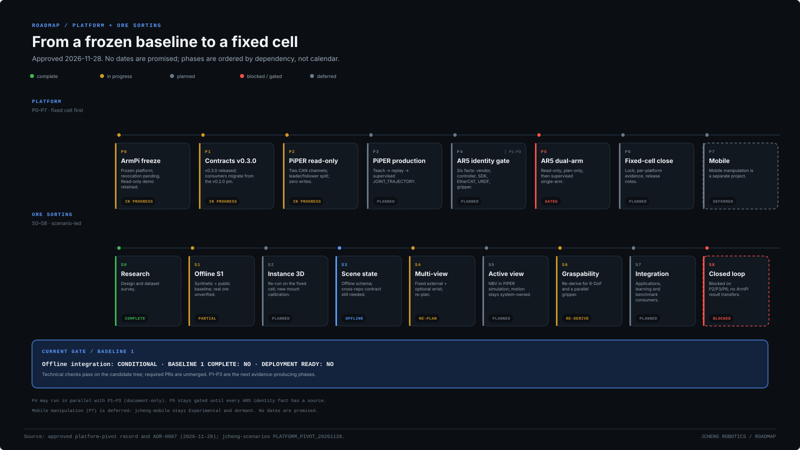
</p>
<p align="center"><sub><a href="https://raw.githubusercontent.com/JCHENG-Robotics/.github/main/profile/assets/roadmap-light.svg">打开全尺寸路线图</a></sub></p>

2026-11-28 批准的转向冻结 ArmPi Ultra，并把平台迁往**固定单元**：PiPER X 作为生产执行臂，AR5 作为需门禁的双臂后继，移动化推迟为独立的 P7 项目。

- **当前门禁：** 基线 1 离线集成为有条件；部署未就绪。
- **进行中：** P0（ArmPi 冻结与运动权威撤销）与 P2（PiPER X 只读）。P1（契约 v0.3.0）是下一个契约门禁。
- **矿石分拣：** S0–S1 为离线；S1 在合成与公开数据上部分验证，真实矿石精度未验证。S8 闭环分拣受 P2/P3/P6 阻断。ArmPi 结果不迁移。

不承诺日期。阶段按依赖排序，而不是按日历排序。阶段表、ArmPi 冻结记录与 AR5 身份门禁见 [docs/platform-transition.md](https://github.com/JCHENG-Robotics/.github/blob/main/docs/platform-transition.md)。

<details>
<summary><strong>阶段索引</strong> —— 范围、状态与出口证据</summary>

| 阶段 | 范围 | 状态 | 出口证据 |
|---|---|---|---|
| **P0** | ArmPi Ultra 冻结；运动权威撤销 | **进行中** | 冻结记录；只读演示；发布者集合记录 |
| **P1** | 契约 v0.3.0：robot-profile v2、`chain_id`、夹爪范围 | **计划中** | v1/v2 可加载；全部门禁通过；Mock 跑 v2 profile |
| **P2** | PiPER X 只读：两路 CAN、零写入 | **进行中** | 30 分钟只读；`writes=0`；与 SDK 一致 |
| **P3** | PiPER X 生产：示教 → 回放 → 受监督执行 | **计划中** | 一次抓放；逐帧 CAN 确认；停止 ≤100 ms |
| **P4** | AR5 身份门禁：六项事实 | **计划中**（可与 P1–P3 并行） | 每项事实有出处或明确未知 |
| **P5** | AR5 只读与双臂 | **门禁中** | 双臂只读；plan-only；单臂 L5 |
| **P6** | 固定单元收尾：锁、证据、发布说明 | **计划中** | 每平台证据与新锁 |
| **P7** | 移动操作 | **推迟** | 单独立项 |

| 矿石阶段 | 范围 | 状态 |
|---|---|---|
| **S0** | 调研与数据集普查 | **完成** |
| **S1** | 离线分割，合成 + 公开基线 | **部分** —— 真实矿石精度未验证 |
| **S2–S7** | 3D 几何、场景状态、多视图、主动视角、可抓取性、集成 | **计划 / 重新推导**（固定单元） |
| **S8** | 闭环分拣 | **受 P2/P3/P6 阻断** |

</details>


## 开发者资源

| 从这里开始 | 构建与测试 | 参与贡献 | 治理 |
|---|---|---|---|
| [生态路线图](https://github.com/JCHENG-Robotics/.github/blob/main/ROADMAP.md) | [基线 1 验收脚本](https://github.com/JCHENG-Robotics/.github/blob/main/dev/baseline1-acceptance.sh) | [贡献指南](https://github.com/JCHENG-Robotics/.github/blob/main/CONTRIBUTING.md) | [仓库边界](https://github.com/JCHENG-Robotics/.github/blob/main/docs/repo-boundaries.md) |
| [验收报告](https://github.com/JCHENG-Robotics/.github/blob/main/ACCEPTANCE.md) | `jcheng-system` Mock 栈（无硬件） | [行为准则](https://github.com/JCHENG-Robotics/.github/blob/main/CODE_OF_CONDUCT.md) | [文档标准](https://github.com/JCHENG-Robotics/.github/blob/main/docs/documentation-standard.md) |
| [基线 1 记录](https://github.com/JCHENG-Robotics/.github/blob/main/docs/baseline1/README.md) | `jcheng-learning` 数据集 CLI（离线） | [安全策略](https://github.com/JCHENG-Robotics/.github/blob/main/SECURITY.md) | [仓库分类](https://github.com/JCHENG-Robotics/.github/blob/main/docs/repo-taxonomy.md) |
| [架构](https://github.com/JCHENG-Robotics/.github/blob/main/docs/architecture.md) · [证据](https://github.com/JCHENG-Robotics/.github/blob/main/docs/evidence.md) · [安全](https://github.com/JCHENG-Robotics/.github/blob/main/docs/safety-and-limitations.md) | ROS 2 Humble（机器人）/ Jazzy（主机）；Python 3.12 | Issue 与设计模板 | [治理](https://github.com/JCHENG-Robotics/.github/blob/main/GOVERNANCE.md) |

## 安全、局限与治理

### 安全模型与不声称的能力

平台**没有硬件急停、抱闸、独立编码器、力矩感知或自碰撞模型**。底盘为开环，没有里程计。软件停止是保持 / 零指令，不是安全等级停止。生态**未通过安全认证**，不声称 SIL/PL 合规。

- 所有实机工作都受监督，并且每次会话都需要**单独、明确的授权**。
- UI 与文档使用“软件停止”或“停止请求”，不使用“急停”。
- 厂商容器重启可能移动机械臂（`startup_check`）；系统不会自动重启厂商容器。
- ArmPi 平台已冻结。运动权威撤销**仍待操作员执行**；只读网关与回滚路径保留。

### 局限与有效性威胁

- **单一平台与场地。** 结果来自一台 ArmPi Ultra、一个桌面设置和少量受监督会话。
- **未通过的门限。** 6 mm RSS 误差预算门限未满足；3.080 mm 放置均值是另一个统计量。
- **快速路径范围。** 4.0/20 配置经过总线确认，但只在一个方向上验证。
- **M6 未完成。** S14 与生态 G8 复验从未开始；平台冻结是退役，不是推迟。基线自身的完整 G8 是另一个已冻结结果。
- **残余未验证项。** S7 陈旧状态注入与 S9 运行时发布者检测仍未验证。
- **能力仍部分。** 移动只有静态启动并已休眠；感知只有一次双视图运行，腕部深度读取仍可能卡死；基准没有套件结果；运维看门狗从未在真实卡死中触发。
- **许可证状态。** 冻结基线与 `jcheng-mobile` 带有 MIT（移动仓保留待审）。**包括本仓在内的 14 个仓库没有 `LICENSE`**，在审查结束前不授予复用。详见[许可证状态](https://github.com/JCHENG-Robotics/.github/blob/main/docs/safety-and-limitations.md#8-license-status)。

### 治理

每个仓库的 `main` 都受保护：Pull Request、独立评审、CODEOWNERS、线性历史、禁止 force-push 或删除，并启用组织合并队列。第二位评审人（`@JerichoSwaine`）拥有维护权限，并在每个仓库担任 CODEOWNER。安全报告遵循 [`SECURITY.md`](https://github.com/JCHENG-Robotics/.github/blob/main/SECURITY.md)；不要在公开 Issue 中披露利用细节或凭据。

## 引用与联系

如果引用该实验基线，请使用：

```bibtex
@software{jcheng_manipulation_2026,
  author  = {Cheng, Kewei (Jericho)},
  title   = {JCHENG Manipulation: A ROS 2-Based Robotic Manipulation System with Quantitative Reliability Evaluation},
  year    = {2026},
  version = {1.0.0},
  url     = {https://github.com/JCHENG-Robotics/jcheng-manipulation}
}
```

- **设计与契约问题：** 在相关仓库提交 `design` Issue。
- **安全：** 遵循 `SECURITY.md`；不要提交公开的利用 Issue。
- **实机工作：** 与操作员协调；不接受远程运动请求。

基线证据索引、失效模式分类与完整实验记录，仍是该平台实测行为的权威参考。
