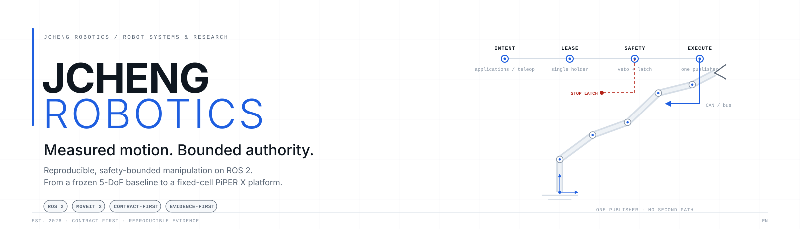
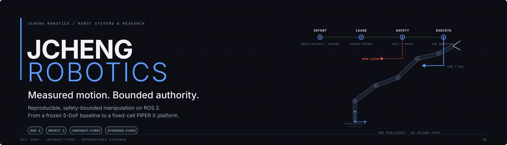

# Organization profile assets

> Status: **v1.0** as of 2026-11-28.  
> These assets support [`../README.md`](../README.md) and
> [`../README.zh-CN.md`](../README.zh-CN.md). They are self-contained: no
> scripts, no external fonts, no external images and no third-party service.

## 1. File map

| File | Size | Purpose |
|---|---|---|
| `banner-en-light.svg` / `banner-en-dark.svg` | 1600×460 | English hero |
| `banner-zh-light.svg` / `banner-zh-dark.svg` | 1600×460 | Chinese hero |
| `architecture-light.svg` / `architecture-dark.svg` | 1600×1020 | Five layers, side planes and hardware plane |
| `dependencies-light.svg` / `dependencies-dark.svg` | 1600×900 | Responsibility clusters, allowed and forbidden edges |
| `motion-path-light.svg` / `motion-path-dark.svg` | 1600×780 | Single motion authorization path |
| `evidence-light.svg` / `evidence-dark.svg` | 1080×840 | Frozen-baseline evidence |
| `learning-workflow-light.svg` / `learning-workflow-dark.svg` | 1600×760 | Data collection and robot learning |
| `roadmap-light.svg` / `roadmap-dark.svg` | 1600×900 | P0–P7 platform and S0–S8 ore-sorting stages |
| `photos/armpi-first-grasp.jpg` | 900×1200 | Real ArmPi Ultra, first grasp |
| `photos/armpi-debug-studio.jpg` | 1100×825 | Frozen baseline operator console |
| `photos/ore-s1-public-overlay.jpg` | 1100×825 | Offline ore S1 overlay on public data |

## 2. Light / dark convention

Every diagram has a light and a dark variant with the same layout and text. The
organization profile uses **absolute raw URLs**, because relative paths are
resolved inconsistently on organization profile pages (web vs mobile):

```html


```

Use both tags together; do not reference only one variant. The two files must be
edited together so text and geometry stay in sync. Document links use absolute
`https://github.com/JCHENG-Robotics/.github/blob/main/...` URLs for the same
reason.

## 3. Photo provenance and licenses

| File | Source | License | Processing |
|---|---|---|---|
| `photos/armpi-first-grasp.jpg` | `jcheng-manipulation/evidence/phase2/onsite_20261118/first_grasp/operator_grasp_20261118.jpg` | Baseline MIT (own photograph) | EXIF orientation applied; resized to 900×1200 |
| `photos/armpi-debug-studio.jpg` | `jcheng-manipulation/evidence/studio_g5/20261118/hardware_dashboard.png` | Baseline MIT (own screenshot) | Cropped to the top 4:3 dashboard; resized to 1100×825 |
| `photos/ore-s1-public-overlay.jpg` | `jcheng-perception/evidence/ore_scene_s1_20261126/overlays/public_40_1.jpg` | **CC BY 4.0**, Mendeley Data “benchmark for rock blasting”, `40_70mm` subset | Cropped to 4:3; resized to 1100×825 |

The ore overlay is a **qualitative** overlay generated offline by
`jcheng-perception` on a public dataset. It is not a metric input and must not be
presented as real-ore accuracy. Keep the CC BY 4.0 attribution in both READMEs.

The legacy 8-week Panda simulation (`jcheng-manipulation/docs/demo.gif`) is
**not** stored here. It is linked from the Hardware section as archived work and
is explicitly **not** ArmPi hardware.

No PiPER X or AR5 photograph exists. Do not substitute a render, a vendor image
or a different platform.

## 4. SVG construction

- Plain SVG primitives only: `<rect>`, `<line>`, `<path>`, `<circle>`, `<text>`.
- No `<script>`, `<foreignObject>`, external `<image>`, remote `@import` or web
  font. The only `http://` string is the required SVG namespace.
- Each file has `<title>` and `<desc>`; the README supplies an `alt` attribute.
- Status is encoded with a text label and a shape/dot, not colour alone.
- The generator is intentionally **not** committed: the organization Python
  policy only permits `scripts/check_boundaries.py` and
  `scripts/test_check_boundaries.py`. Edit the SVGs directly, or regenerate
  out-of-tree and copy the files.

## 5. Palette

| Token | Light | Dark |
|---|---|---|
| Background | `#FFFFFF` | `#0B0F14` |
| Panel | `#F6F8FA` | `#111820` |
| Border | `#D5DDE6` | `#263341` |
| Text | `#0F1720` | `#F2F5F8` |
| Muted | `#5A6675` | `#9AA8B6` |
| Industrial blue | `#1F5FE0` | `#5B9BFF` |
| Verified green | `#1A7F37` | `#3FB950` |
| Partial amber | `#8A5A00` | `#D29922` |
| Failed / blocked red | `#B42318` | `#F85149` |
| Frozen blue | `#0B6BCB` | `#58A6FF` |

## 6. Maintenance

1. Change the light and dark variants together.
2. Keep viewBox dimensions unchanged; the README assumes the aspect ratio.
3. Do not add new claims to a diagram unless the same claim is in the README and
   traceable to a repository record.
4. If an asset is replaced, update the provenance table and the README caption.
5. Keep file names stable; external links may point at the full-size SVG.

## 7. Evidence links

- Baseline evidence: `jcheng-manipulation/evidence/`.
- Baseline 1: [`../../docs/baseline1/`](../../docs/baseline1/README.md).
- Platform transition: [`../../docs/platform-transition.md`](../../docs/platform-transition.md).
- Safety and limitations: [`../../docs/safety-and-limitations.md`](../../docs/safety-and-limitations.md).
